# Tarea Sesión 2.1

Bioinformática y análisis genómicos reproducibles

Joaquín Torres Nuñez

Profesor: Ricardo Verdugo


## Realizar las siguientes tareas tanto para las secuencias crudas y podadas. Además de generar los informes de calidades deben realizar una comparación de los resultados. Recuerden que la ubicación de las secuencias crudas es en el directorio: 181004_curso_calidad_datos_NGS/fastq_raw/ y las secuencias ya podadas se encuentran en 181004_curso_calidad_datos_NGS/fastq_filter
    
    Usando comandos Unix:

1. Contar el número de lecturas (reads) en un archivo fastq
Se tomara como ejemplo el archivo fastq_raw S14_R1.fastq y  S14_R1_filter.fastq
zgrep -c "^+$" S14_R1.fastq.gz
10209 reads

zgrep -c "^+$" S14_R1_filter.fastq.gz
8038 reads

Se evidencia una clara disminución en el numero de reads post filtrado. 


2. Previsualizar las primeras 40 líneas del mismo archivo fastq
```
zcat ../181004_curso_calidad_datos_NGS/fastq_raw/S3_R1.fastq.gz | head -n 40
zcat ../181004_curso_calidad_datos_NGS/fastq_filter/S3_R1_filter.fastq.gz | head -n 40

```

3. Ubicar la lectura 3 e identificar la información disponible. Describir en detalle la información entregada. ¿Donde se entrega la calidad del read?, ¿Cuál es el ID (identificador) del read? Etc. Utilice fechas y etiquetas para identificar cada parte. 
```
zcat ../181004_curso_calidad_datos_NGS/fastq_raw/S3_R1.fastq.gz | head -n 12 | tail -n 4
```

- Se entregan 4 líneas de informarción en la consola:
    - La primera corresponde a los datos de identificación de la lectura. 
    - La segunda linea entrega la seucencia nuebelotidica del fragemnto.
    - Posteriormente viene un atercer alínea "+" la cual cumple la función de separador. 
    - Finalemnte la cuarta línea corresponde a la infromación de la calidad de la secuencia, donde cada letra/simbolo representa un score de caldiad (Phred score)

La calidad del read se entrega en la cuarta linea, representada en simbolos particulares por cada base que compone la secuencia. 

Id de la muetra: @M03564:2:000000000-D29D3:1:1101:16551:1405 1:N:0:ATCACGAC+TAAGACAC

4. Traducir el código de calidad para las primeras 10 bases del tercer read a valores numéricos (Q) usando la codificación entregada en clase.
Secuencia nucleotídica: AAGCTGACAG
Calidad de la secuencia: CCBCCFFFFF

En base a la tabla ASCI base-33 la traducción del código a Phred score por base sería:
34/34/33/34/34/37/37/37/37/37

5.Determinar el número de regiones blanco en el panel, analizando el archivo ls 181004_curso_calidad_datos_NGS/regiones_blanco.bed
El archivo regiones_blanco.bed que estás analizando es el archivo de coordenadas genómicas que define la lista exacta de esas regiones blanco en el genoma de referencia.

wc -l ../181004_curso_calidad_datos_NGS/regiones_blanco.bed
Archivo contiene 369 regiones blanco

6. Genere una lista de símbolos de genes encestados (solo valores distintos)

7. Cuente cuántos genes hay en la lista

## 2. Genere un informe de calidad con FastQC para una muestra (cada estudiante una muestra distinta), para R1 y R2.
Se realizará un informe de calidad para la secuencia S14_R1.fastqc.gz/S14_R1.fastqc.gz de secuencias crudas y podadas

### 1 
- 1. Reporte de lecturas crudas (Raw)
fastqc ../181004_curso_calidad_datos_NGS/fastq_raw/SX_R1.fastq.gz ../181004_curso_calidad_datos_NGS/fastq_raw/SX_R2.fastq.gz -o .

- 2. Reporte de lecturas filtradas (Filter)
fastqc ../181004_curso_calidad_datos_NGS/fastq_filter/S14_R1_filter.fastq.gz ../181004_curso_calidad_datos_NGS/fastq_filter/S14_R2_filter.fastq.gz -o .

3. Baje los archivos HTML a su computados mediante sftp (puede usar cualquier cliente o la línea de comandos. Por ejemplo, ejecutando desde su computador local: scp  bioinfo1@genoma.med.uchile.cl:ricardo/S3_R1_fastqc* .  
scp bioinfo1@genoma.med.uchile.cl:~/jtorresnunez/*.html .

4. Analice el informe de calidad creado con fastqc para las lecturas R1 y R2.

S14_R1_fastqc: Se analizó un total de 10209 lecutras, con un total de 2.5 MB. Con un largo de secuencias de 251 pb. Al analizar el gráfico "per base sequence quality se observa que desde las bases 165-169 decae la calidad de la secuencia, donde en secuencias finales decae (>239) decae bajo 30 Phred score.
Tanto "Per tile sequence quality", como "Per sequence quality scores" aprobaron en calidad. Se observa una advertenia en "Per base sequence content" reflejado en un desvío en la proporcon de bases nucleotidicas A,T,C,G. "Per sequence GC content" falló, no obstante este elemento debe ser tomado en consideración dado que se basa en genoma humano, en casos de genomas no convencionales dicha proprcion podria no siempre ser lo normal. "Per base N content", "Sequence Length Distribution" fueron aprobados en su calidad. Sequence Duplication Levels falló indicando alto % de lecturas duplicadas, detectandoa demas la presencia de adaptadores, lo que tiene sentido puesto que aun no se aplica filtro ni trimming a las secuencias.

S14_R1_fastqc: Se observó de igual forma un total de 10209 lecturas, con un total de 2.5 MB, no obstante, como era de esperar, estas poseen una menor calidad, disminuyendo el Phred score de forma drástica a partir de la base 135-139, observandose un score de claidad <30 desde las bases 185-189. ESta disminución de la calidad se refleja en señales de "Warning" en "per base sequence quality" y señakes de "fail" en "per base sequecne content

S14_R1_filterfastqc: A diferencia de S14_raw, al aplicar filtro se evidencian cambios importantes en el informe de caldiad. Disminuyen de forma significativa el número de lecturas anlizadas (8038 secuencias), con un total de 1.8 Mbp. A su vez dsiminuyó el largo de la secuencia a un fragmento que va desde ñas bses 36-251.  Calidad de las bases (Per base sequence quality - PASS): El archivo filtrado no registra secuencias marcadas como de mala calidad (0 lecturas malas) y obtiene la calificación máxima (PASS). El archivo no filtrado presentaba caídas en los puntajes de calidad Phred hacia el final de la lectura.
Contenido de adaptadores (Adapter Content - PASS): Muestra que los adaptadores de secuenciación fueron removidos exitosamente por debajo del umbral de detección (PASS).
Contenido de bases N (Per base N content - PASS): Las posiciones con bases no determinadas ('N') fueron eliminadas o recortadas correctamente (PASS).

S14_R2_filterfastqc: Longitud variable de secuencias (Recorte / Trimming): La longitud de lectura pasó de ser fija a un rango de 35 a 251 pares de bases. Esto generó una advertencia (WARNING) en el módulo Sequence Length Distribution, lo cual es el comportamiento esperado tras aplicar algoritmos de recorte por calidad o remoción de adaptadores. Eliminación de adaptadores (Adapter Content): El módulo muestra un estado satisfactorio (PASS), confirmando que los adaptadores presentes en las lecturas crudas fueron removidos con éxito. Alta calidad por base (Per base sequence quality): El módulo obtuvo la calificación PASS, lo que indica que se descartaron las lecturas o bases con puntuaciones de calidad Phred deficientes (habituales hacia el extremo 3' en lecturas R2). Recuento total de secuencias retenidas: Tras el filtrado, el archivo conserva un total de 8,038 secuencias (~1.6 Mbp) con 0 secuencias marcadas como deficientes (poor quality).

5. 
- número de lecturas:  
S14_R1_fastqc comandos UNIX: 10209 reads
S14_R1_fastqc FASTQC: 10209 reads
S14_R2_fastqc comandos UNIX:10209  reads
S14_R2_fastqc FastQc: 10029 reads
S14_R1_filter_fastqc comandos UNIX: 8038
S14_R1_filter_fastqc FastQc: 8038
S14_R2_filter_fastqc comandos UNIX: 8038
S14_R2_filter_fastqc FastQc: 8038 
No se evidencia cambios en el número de reads entre comandos Unix y programa FastQc.

- Calidad de las secuencias
Secuencia S14_fastqc primeras 10 bases: 
R1: ACTAAGGAAC
R2: ATCTATATTC
Qscores S14_R1_fastqc: EEEEEFFFFF
Qscores S14_R2_fastqc: ABCCCFFFFF

Qscores en informe de calidad FastQC
S14_R1_fastqc: 34/34/34/35/35/36/36/36/37
S14_R2_fastqc: 33/33/34//34/34/36/36/36/37

Qscores de secuencias filtradas en informe de calidad FastQC
S14_R1_filter_fastqc: 34/34/34/35/35/36/36/36/36/37
S14_R2_filter_fastqc: 34/34/34/34/34/36/36/36/36/37

No hubo una gran variación de los Phred scores entre el analisis de Qscores, y el análsis efectuado por FastQc.  

6. 4 figuras más importantes

a. Per base sequence quality
Esta figura muestra la distribución del puntaje Phred (*Q*) para cada posición del ciclo de secuenciación a lo largo de las lecturas
| Condición | Read 1 (R1) | Read 2 (R2) |
| :--- | :---: | :---: |
| **Crudas (Raw)** | 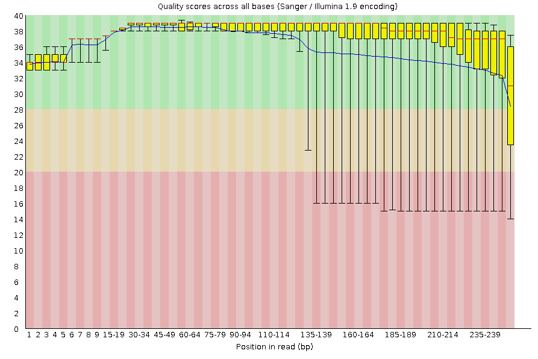 | 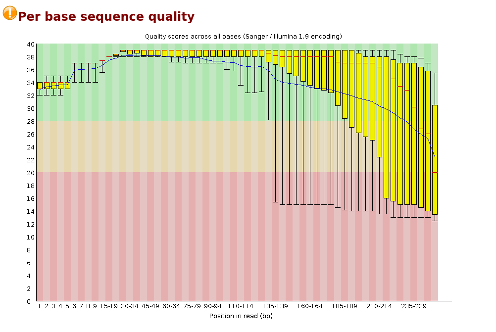 |
| **Podadas (Filter)** | 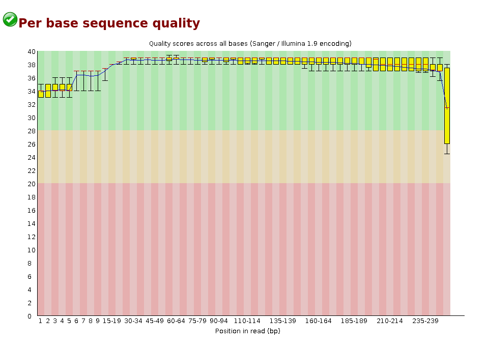 | 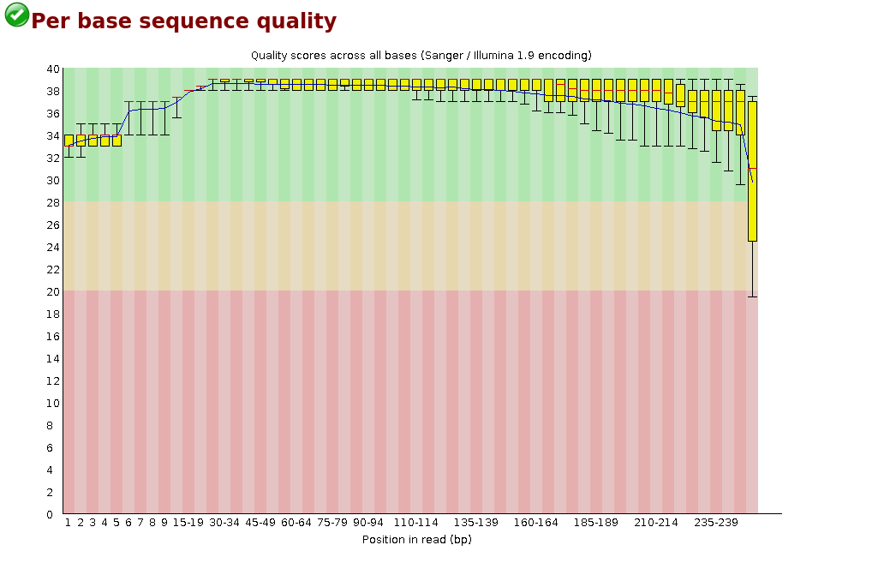 |

### Interpretación y Comparación:
* **Secuencias Crudas (Raw):** 
  * **R1:** Mantiene puntajes de calidad Phred altos ($Q > 30$) a lo largo de casi todo el ciclo de lectura, con un leve descenso en los últimos nucleótidos del extremo 3'.
  * **R2:** Muestra una caída más acentuada de calidad hacia el extremo 3', ingresando en las zonas amarilla ($Q20-Q30$) y roja ($Q < 20$). Esta asimetría es típica en secuenciación *paired-end* por el agotamiento progresivo de reactivos y acumulación de desfase de fase (*phasing/pre-phasing*).
* **Secuencias Podadas (Filter):** 
  * El proceso de podado (*trimming*) removió exitosamente las bases degradadas del extremo 3'. En ambos archivos (**R1** y **R2**), el 100% de las posiciones conservadas se posiciona firmemente en la zona de alta calidad ($Q > 28$).

---

## 2. Per Sequence Quality Scores (Distribución de Calidad por Lectura)

| Condición | Read 1 (R1) | Read 2 (R2) |
| :--- | :---: | :---: |
| **Crudas (Raw)** |  | 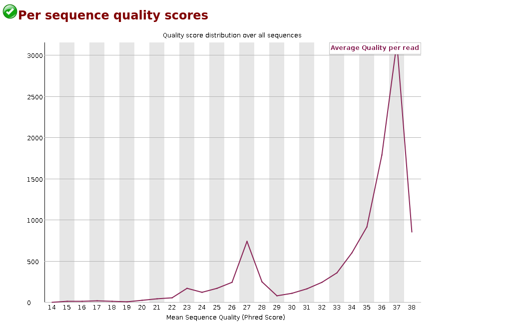 |
| **Podadas (Filter)** | 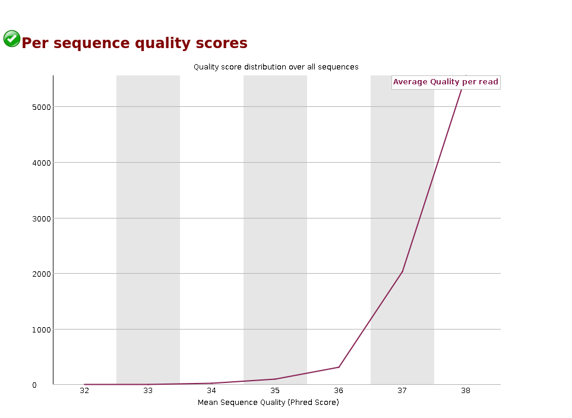 | 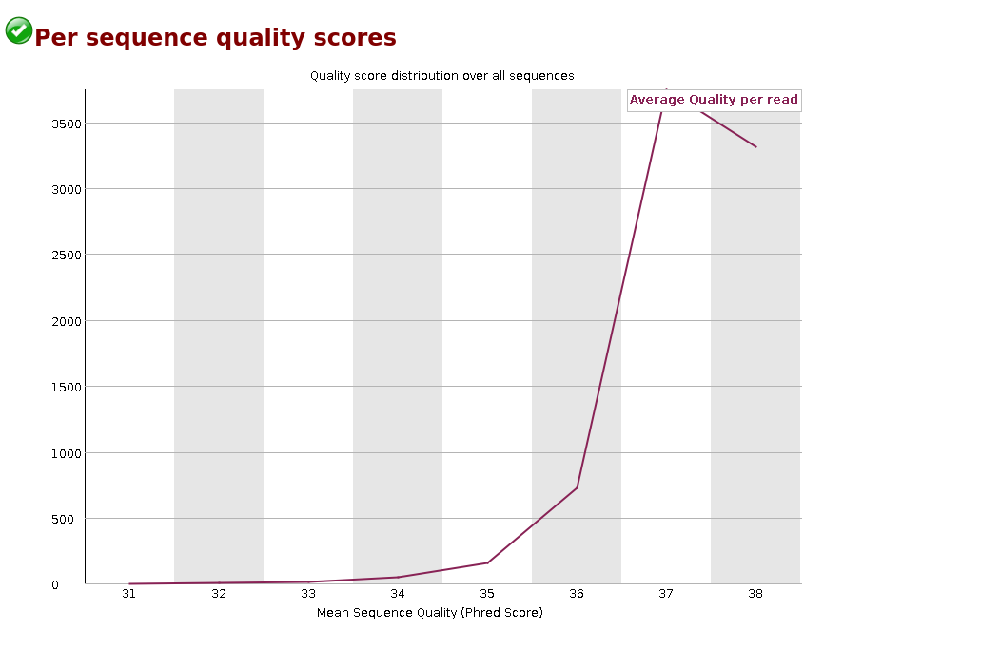 |

### Interpretación y Comparación:
* **Secuencias Crudas (Raw):** 
  * **R1** presenta una distribución unimodal ideal con un pico centrado cerca de $Q35$, lo que indica que la mayoría de las lecturas tienen una calidad promedio sobresaliente.
  * **R2** muestra una curva desplazada hacia la izquierda ($\sim Q28$), a menudo con un segundo pico o "hombro" en valores bajos ($Q < 20$), reflejando un grupo de lecturas de baja confianza.
* **Secuencias Podadas (Filter):** 
  * Tras el filtrado, la fracción de lecturas deficientes en **R2** desaparece por completo. Ambas curvas (**R1** y **R2**) se vuelven simétricas y alineadas con picos superiores a $Q32$.

---

## 3. Per Base Sequence Content (Composición de Bases por Posición)

| Condición | Read 1 (R1) | Read 2 (R2) |
| :--- | :---: | :---: |
| **Crudas (Raw)** | 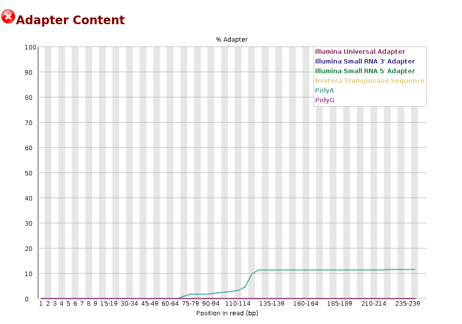 | 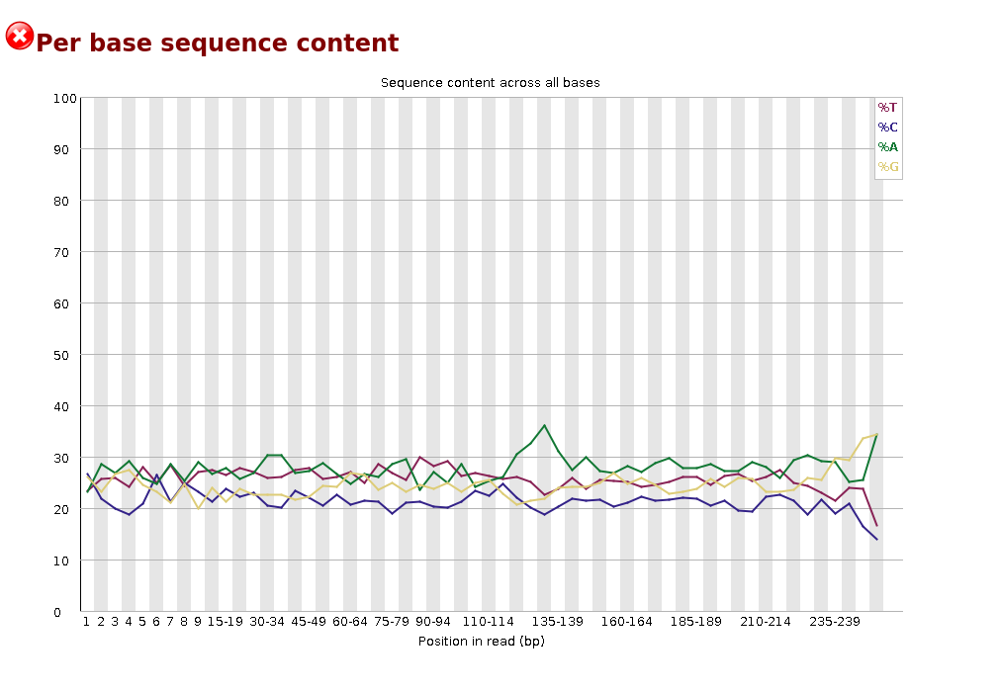 |
| **Podadas (Filter)** | 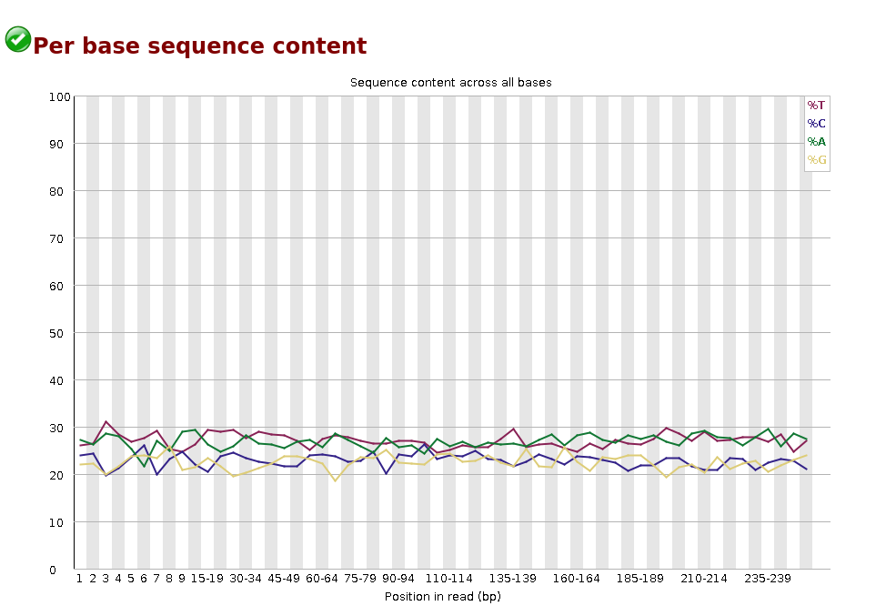 | 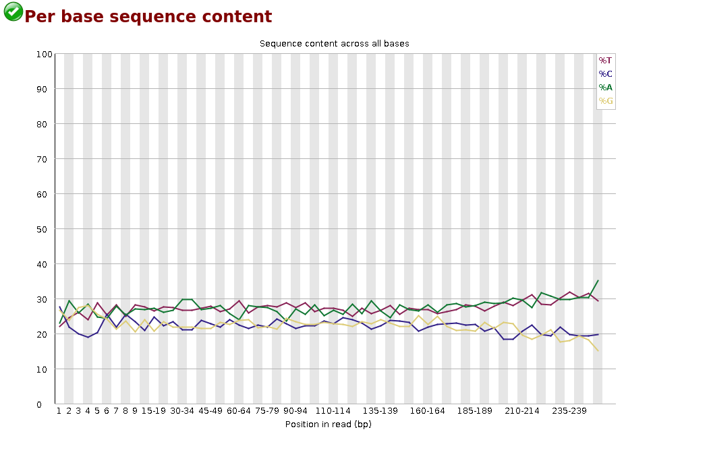 |

### Interpretación y Comparación:
* **Secuencias Crudas (Raw):** 
  * En los primeros 10–12 pares de bases se observan fluctuaciones en las proporciones de nucleótidos debido al sesgo de hibridación inicial (*random hexamer priming*).
  * Hacia el extremo 3' de **R1** y **R2**, las líneas de bases pierden paralelismo debido a la presencia de lecturas que atravesaron insertos cortos e ingresaron a regiones con adaptadores.
* **Secuencias Podadas (Filter):** 
  * Al cortar las secuencias sintéticas y recortar los extremos de mala calidad, las proporciones de nucleótidos a lo largo del cuerpo de la lectura se estabilizan y corren paralelas, reflejando fielmente la composición real del genoma.

---

## 4. Adapter Content (Contenido de Adaptadores)

| Condición | Read 1 (R1) | Read 2 (R2) |
| :--- | :---: | :---: |
| **Crudas (Raw)** | 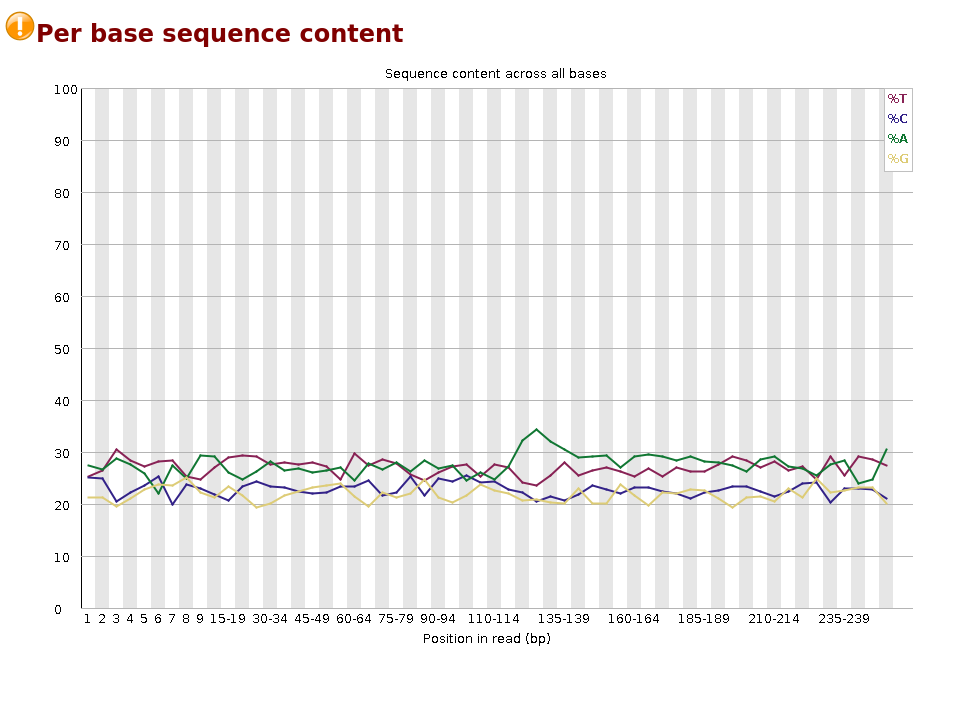 | 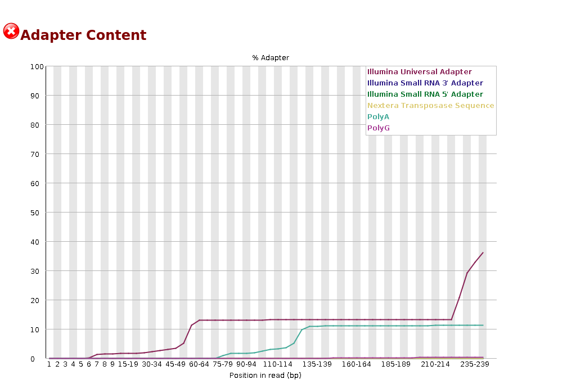 |
| **Podadas (Filter)** | 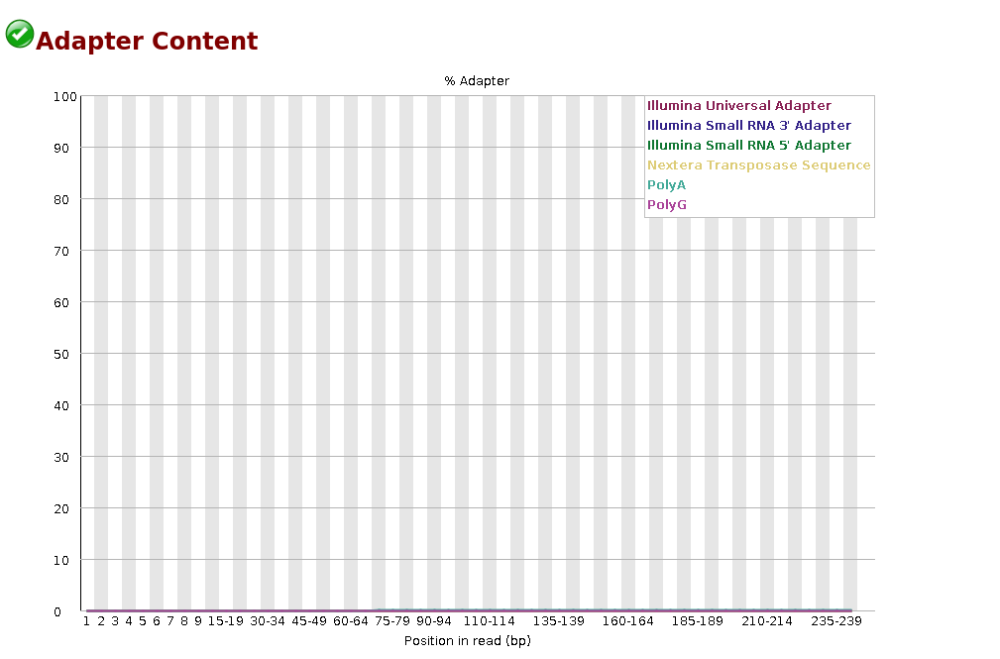 | 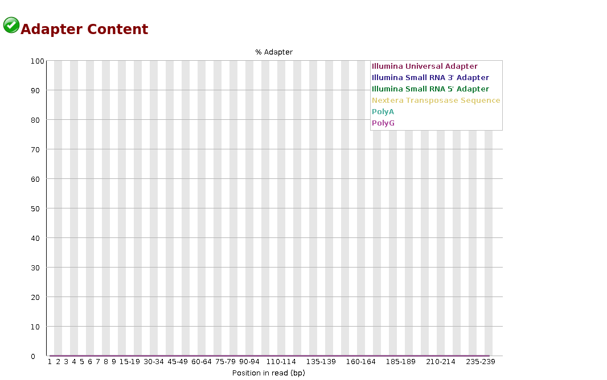 |

### Interpretación y Comparación:
* **Secuencias Crudas (Raw):** 
  * Muestra una acumulación progresiva de secuencias de adaptadores hacia el extremo 3'. En **R2** la contaminación suele detectarse antes debido a fragmentos de lectura donde se leyó completamente el inserto.
* **Secuencias Podadas (Filter):** 
  * La tasa de contaminación por adaptadores cae al **0%** plano a lo largo de toda la lectura tanto para **R1** como para **R2**, confirmando la efectividad del software de *trimming*.


